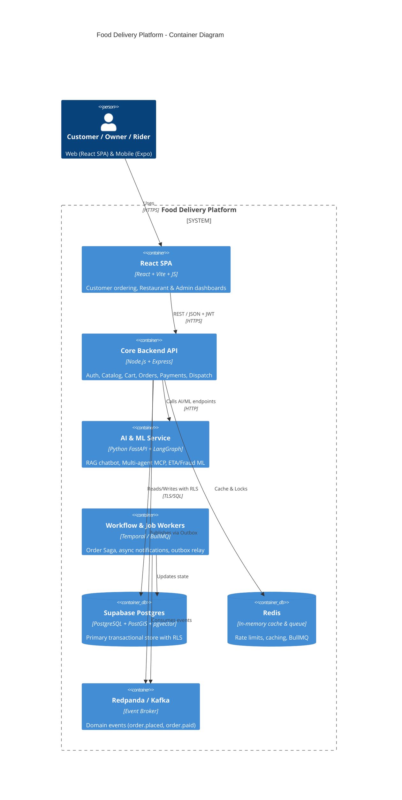

# System Architecture & Design (Day 1)

## 1. Bounded Contexts (Domain-Driven Design)

1. **Catalog (`restaurants`, `menu`, `search`)**: Restaurant profiles, menus, pricing, geo/hybrid search.
2. **Orders (`cart`, `orders`)**: Cart state, order creation, order state machine, live order queue.
3. **Payments (`payments`, `coupons`)**: Razorpay/Stripe charges, webhooks, idempotency, refunds.
4. **Dispatch (`delivery`, `realtime`, `notifications`)**: Rider assignment, live location tracking, route batching, FCM/email alerts.
5. **AI (`ai`)**: Bridge to Python FastAPI + LangGraph service (RAG, embeddings, multi-agent orchestration, ML predictions).

---

## 2. C4 Container Diagram

